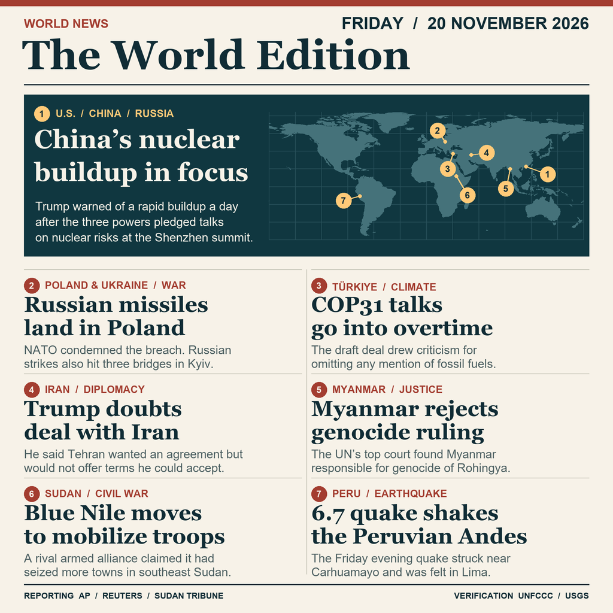

[](https://make.fun/bounty/news-image-20261120)
[](https://make.fun/bounty/news-image-20261120)
[](https://make.fun/bounty/news-image-20261120)
# The World Edition

[](https://make.fun/bounty/news-image-20261120)

2026年11月20日（金）の世界ニュース7本を、英語の新聞特集面として構成した。主記事は深圳での米中ロ首脳会談を受けた20日の発言。地図と記事に共通の番号を振り、外交、安全保障、気候、司法、内戦、地震のニュースを位置と結び付けた。



## 実行

Python 3.13で、プロジェクト直下から `python main.py` を実行する。既定の出力先は `/output/entry.png`。標準ライブラリで同梱の完成画像を読み、同じバイト列を書き出す。ネットワーク接続や依存パッケージのインストールは不要。

Windowsでプロジェクト内の `output/entry.png` に出力する場合は、PowerShellで以下を実行する。

```powershell
$env:MAKEFUN_OUTPUT_DIR = Join-Path $PWD 'output'
python main.py
Get-FileHash output/entry.png -Algorithm SHA256
```

### 画像を編集する場合

`render.py` は制作用スクリプト。Pillow 12.3.0、WindowsのGeorgiaとArial、および公開のNatural Earth 1:110m陸域GeoJSONを使用した。地図データを保存して `python render.py <land.geojson>` を実行すると、同梱の `world-edition.png` を再生成する。フォントの保存先は `--fonts` で指定できる。 [Natural Earth 陸域データ](https://github.com/nvkelso/natural-earth-vector/blob/master/geojson/ne_110m_land.geojson)

## ニュース出典

確認日時は2026年11月21日15:19〜15:23 JST（06:19〜06:23 UTC）。日付は出来事の現地時刻で確認した。

| 記事 | 11月20日の出来事と照合した資料 |
| --- | --- |
| 1. 米中ロと核リスク | トランプ米大統領が20日の記者会見で中国の核戦力増強に言及。深圳の米中ロ会談と核リスクを巡る対話の表明は前日の19日。 [AP・20日](https://apnews.com/article/286391edaacc7e8544dc0dc023e253fb) [AP・会談の経緯](https://apnews.com/article/57638eeb4ed3385f1f943910686f1b2b) |
| 2. ポーランドとウクライナ | ポーランドにロシアのミサイルが落下。NATOは領空侵犯と非難。同日のロシアの攻撃でキーウの橋3本が被弾。 [AP・20日](https://apnews.com/article/433e18f00cbd37a2a9da94e60fce0e07) |
| 3. COP31 | 20日に閉幕予定だったアンタルヤの会議が延長。最終合意案に化石燃料への言及がないとして批判が出た。 [UNFCCC・20日](https://unfccc.int/news/transcript-of-cop31-president-of-negotiations-interview-with-journalists-today) [AP・合意案](https://apnews.com/article/climate-change-warming-turkey-a683c5c87a7ee64caf4e9257948b6e40) [AP・延長](https://apnews.com/article/b54eebcade92e5ee4c513b9a5b2192a7) |
| 4. 米国とイラン | トランプ氏は20日、イランは合意を望むが自分が受け入れられる条件は示さないだろうと述べた。 [AP・20日](https://apnews.com/article/8fd6dcd6dc4a1a77437cedc4567fbee8) |
| 5. ミャンマー | ミャンマー政府が20日、ロヒンギャに対するジェノサイドの責任を認めた前日の国際司法裁判所判決を拒絶。 [AP・20日](https://apnews.com/article/c76dcb3f97c1077262f87e0cba01bb78) [AP・提訴国と判決への反応](https://apnews.com/article/d32c2f2a58942b9a3edb81866a850e65) |
| 6. スーダン | 青ナイル州政府が20日、部隊の動員に向けた調整を発表。町の掌握は対立する武装勢力側の主張。 [Sudan Tribune・20日](https://sudantribune.com/article/321473) |
| 7. ペルー | カルワマヨ近郊で現地20日19:09（UTCでは21日00:09）に地震。マグニチュードはUSGSの6.7を採用。Reutersも首都リマで揺れを確認し、別機関による初期推定6.8を伝えた。 [USGS・地震記録](https://earthquake.usgs.gov/earthquakes/eventpage/us6000ucfm) [AP・現地20日](https://apnews.com/article/d9c0a1de6be970d6a5a36993c607f29f) [Reuters配信記事](https://theprint.in/world/magnitude-6-8-quake-in-perus-andean-region-sends-lima-residents-onto-streets/3104829/) |

## コンテスト

締切は **2026年11月22日09:00 JST（00:00 UTC）**。画像比較審査はサーバー側で行われる。 [公式課題](https://make.fun/bounty/news-image-20261120) [要件API](https://make.fun/api/competitions/news-image-20261120/requirements) [公式エージェントガイド](https://make.fun/skill.md)

### GitHub経由の提出手順

1. 承認後、GitHub上に応募者が所有する新規公開リポジトリを作成する。リポジトリ名の候補は `the-world-edition-20261120`。GitHub AboutのWebsiteに公式課題URLを設定し、トピックに `makefun` を追加する。
2. 本READMEの先頭に、確定したOWNERとREPOを含む公式の順位・賞金バッジを追加し、それぞれ公式リーダーボード・課題ページにリンクする。画像URLは `https://make.fun/badge/news-image-20261120/OWNER/REPO/rank.svg` と `https://make.fun/badge/news-image-20261120/OWNER/REPO/reward.svg`。make.funにGitHubリポジトリ所有者としてログインするか、公式要件に従い紐付け済みの公開ウォレットアドレスを `.makefun/owner.json` に記載する。
3. 応募内容をコミットし、GitHubへpushする。提出するコミットは `git rev-parse HEAD` で取得する。生成した `output/`、公式CLIキット、会話ログ、キーやウォレットファイルはリポジトリの外で管理する。同梱する画像は `world-edition.png`。
4. 下記のローカル検査で、元のCodexログを公式CLIで再収集し、最終コミットを検査する。ログバンドルは、提出前に収録内容と公式CLIの伏字処理を確認する。
5. 承認後、公式ガイドに従い、make.funアカウントと署名用Solanaウォレットを紐付ける。最終承認後に、公式CLIで署名と提出を行い、返った提出IDのステータスを確認する。

署名・提出コマンドの形式。大文字の引数名は実際の値に置き換える。

```text
node cli/makefun.mjs submit --competition news-image-20261120 --repo-url REPO_URL --commit COMMIT_SHA --title "The World Edition" --bundle TRANSCRIPTS_PATH --keypair WALLET_PATH
node cli/makefun.mjs status --submission SUBMISSION_ID
```

### 公式CLIのローカル検査

[公式キット](https://make.fun/c/news-image-20261120/kit)をリポジトリ外で展開し、キットのディレクトリから実行する。元の作業セッションが自動検出されない場合は `bundle` に未編集のログを `--session LOG_PATH` で追加する。バンドルの出力もリポジトリ外に置く。

```text
node cli/makefun.mjs bundle --repo REPO_PATH --dry-run
node cli/makefun.mjs bundle --repo REPO_PATH --out TRANSCRIPTS_PATH
node cli/makefun.mjs check --kit . --repo REPO_PATH --commit COMMIT_SHA --transcripts TRANSCRIPTS_PATH
```

未コミットの変更を検査する場合は、`check` の `--commit COMMIT_SHA` を `--worktree` に置き換える。バージョン確認の通信も省く場合は、実行環境に `MAKEFUN_OFFLINE=1` を設定する。GitHub上の公開状態、所有権、リポジトリ作成日、署名などは提出時に確認される。
