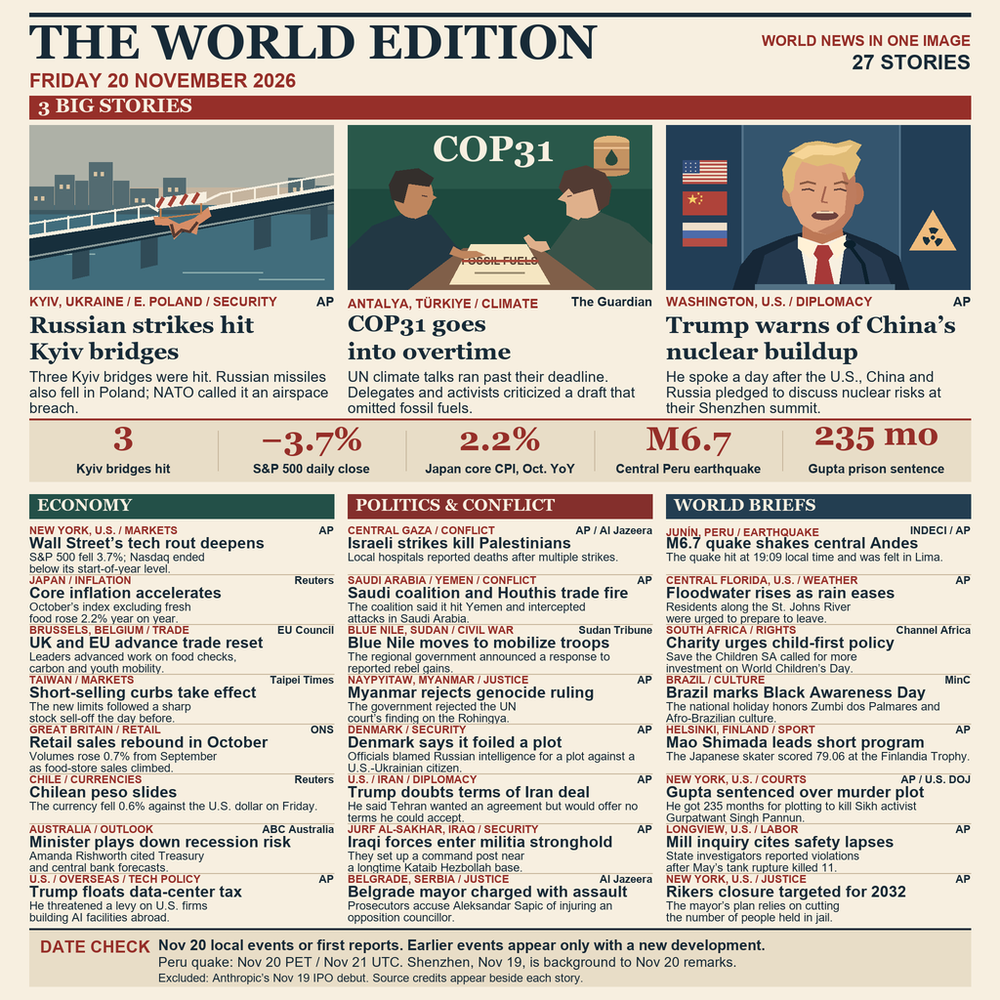

[](https://make.fun/bounty/news-image-20261120)
[](https://make.fun/bounty/news-image-20261120)
[](https://make.fun/bounty/news-image-20261120)

# The World Edition

2026年11月20日（金）の世界ニュース27件をまとめた英語版。Ver.5はVer.3の紙面に戻し、上段に「3 BIG STORIES」の見出しと新しい挿絵を配置した。中央の数値帯、下段の3分野各8件、場所、出典、DATE CHECKはVer.3と同じ。



[Ver.1](world-edition.png) · [Ver.2](world-edition-newsroom.png) · [Ver.3](world-edition-v3.png) · [Ver.4](world-edition-v4.png)

## 実行

Python 3.13で、プロジェクト直下から `python main.py` を実行するとVer.5を出力する。既定の出力先は `/output/entry.png`。標準ライブラリで同梱の完成画像を読み、同じバイト列を書き出す。旧版は `--version 1` から `--version 4` で選択できる。各版の出力を並べて保存する場合は、出力先を版ごとに指定する。ネットワーク接続や依存パッケージのインストールは不要。

Windowsでプロジェクト内の `output/entry.png` に出力する場合は、PowerShellで以下を実行する。

```powershell
$env:MAKEFUN_OUTPUT_DIR = Join-Path $PWD 'output'
python main.py
Get-FileHash output/entry.png -Algorithm SHA256
```

### 画像を編集する場合

`python render_v5.py` でVer.5を再描画できる。制作時は Pillow 12.3.0 と Arial、Georgia を使用する。フォントの場所は `--fonts` で指定できる。記事と出典は [Ver.3の編集台帳](edition_v3.py) を共用している。

### Ver.5の挿絵

キーウでは、報道で確認した橋の損傷と一時的な通行制限をもとに、川と街並みを背にした橋を大きく描いた。損傷やバリケードの形状は編集上の表現。COP31では、交渉に臨む代表者を大きく置き、合意案から化石燃料への言及が外れたことを紙面上の取り消し線で表した。核戦力報道では、会見中のトランプ氏の顔と上半身を中心に描き、米中ロの国旗と警告標識は記事の背景を示す要素として左右に配置した。本文では19日の深圳会談と20日の発言を区別した。 [キーウ・通行情報](https://www.pravda.com.ua/eng/news/2026/11/20/8063728/index.amp) · [COP31・The Guardian](https://www.theguardian.com/environment/2026/nov/20/cop31-talks-overtime-fossil-fuels-vanish-from-draft-deal) · [深圳共同宣言](https://www.fmprc.gov.cn/eng/xw/zyxw/202611/t20261119_12063224.html) · [20日の会見・AP](https://apnews.com/article/286391edaacc7e8544dc0dc023e253fb)

### 旧版の再描画

`python render_v4.py` でVer.4を再描画できる。描画にはPillow 12.3.0、ArialとGeorgia、同梱のNatural Earthの陸域データを使う。フォントの場所は `--fonts` で指定できる。採用記事IDと座標は [render_v4.py](render_v4.py)、出典は [編集台帳](edition_v3.py) に記載した。 [Natural Earth 陸域データ](https://github.com/nvkelso/natural-earth-vector/blob/master/geojson/ne_110m_land.geojson)

### Ver.4の図解と地図

掲載18件を2026年11月22日JSTに再照合した。キーウの3橋は市長が発表した橋名を採用し、ドニプロ川を渡る関係を模式図で示した。被害箇所の形状や程度は模式図に反映していない。「11 REGIONS」はウクライナ国内で緊急停電が起きた地域数。COP31は20日に協議が延長された時点を掲載し、深圳の3か国会談（19日）とワシントンでの発言（20日）を時系列で区別した。 [キーウの橋・Kyiv Independent](https://kyivindependent.com/russia-launches-mass-missile-attack-against-ukraine-after-putin-vows-revenge/) · [停電・AP](https://apnews.com/article/433e18f00cbd37a2a9da94e60fce0e07) · [COP31・UNFCCC](https://unfccc.int/cop31) · [深圳の共同宣言](https://www.fmprc.gov.cn/eng/xw/zyxw/202611/t20261119_12063224.html)

番号の引き出し線は発生地、会場、発表地、または地域の代表地点を指す。複数地点を扱う01はキーウ、09は中部ガザのデイル・アルバラフ、10はイエメンのホデイダ、15はセントジョンズ川沿いのサンフォードを採用。日本、台湾、チリ、デンマーク、南アフリカ、ブラジルは記事の対象地域を示すため、東京、台北、サンティアゴ、コペンハーゲン、プレトリア、ブラジリアを代表点とした。ペルー地震の座標は現地当局の発表を使用した。 [Natural Earth 地名データ](https://www.naturalearthdata.com/downloads/10m-cultural-vectors/10m-populated-places/) · [GeoNames・デイル・アルバラフ](https://www.geonames.org/281141/dayr-al-balah.html) · [GeoNames・コペンハーゲン](https://www.geonames.org/2618424/copenhagen.html) · [ペルー防災当局](https://portal.indeci.gob.pe/emergencias/reporte-preliminar-n-o-1159-20-11-2026-coen-indeci-1940-horas-sismo-de-magnitud-6-7-con-epicentro-en-el-junin-junin/)

`python render_v3.py --fonts <フォントのディレクトリ>` でVer.3のPNGを再描画する。制作用にPillow 12.3.0とWindowsのArial、Georgiaを使用した。挿絵は各記事の場面を伝えるオリジナルの図解。画像の出力処理にPillowやフォントは不要。

`render_newsroom.py` はVersion 2の制作用スクリプト。Pillow 12.3.0、WindowsのArialとGeorgia、Natural Earth 1:110m陸域GeoJSONのローカルコピーを用意し、`python render_newsroom.py <land.geojson>` で `world-edition-newsroom.png` を生成する。Version 1の制作用スクリプトは `render.py`。フォントの保存先は `--fonts` で指定できる。 [Natural Earth 陸域データ](https://github.com/nvkelso/natural-earth-vector/blob/master/geojson/ne_110m_land.geojson)

### Ver.3の出典と日付

[編集台帳](edition_v3.py)に記事ID、発生日、確認できた報道・公表日時、場所、分野、見出し、要約、数値、出典URL、確認状態を記録した。確認日時は2026年11月21日23:28〜23:34 JST。日時が不明な箇所は時刻未確認とし、記録した報道時刻を他媒体も含む最初の報道時刻とはみなしていない。

現地で11月20日に起きた出来事、またはその日に公になった新情報を掲載した。ミャンマーの判決と深圳会談は19日で、20日の政府の反応・米大統領発言を採用した。ペルーの地震は現地20日19:09（UTC 21日00:09）。ガザの死者数は媒体間に差があるため紙面から外した。 [ペルー・AP](https://apnews.com/article/d9c0a1de6be970d6a5a36993c607f29f) · [ガザ・Al Jazeera](https://www.aljazeera.com/news/2026/11/20/israeli-drone-attacks-kill-seven-palestinians-in-central-gaza) · [グプタ被告判決・米司法省](https://www.justice.gov/usao-sdny/pr/indian-national-sentenced-235-months-prison-plotting-assassinate-us-citizen-new-york)

### Version 2の出典と掲載基準

30件それぞれの見出し、媒体名、出典URLは [edition_news.py](edition_news.py) に記録した。確認は2026年11月21日17:14〜17:20 JST。現地で11月20日に起きた出来事、または同日に初めて公に報じられた内容を採用した。ワシントン州の工場事故は5月に起きたため、20日に公表された調査結果のみを掲載した。台湾の空売り制限は発表の翌日である20日の施行を扱った。Anthropicの上場初日とケニアの鉱山事業の選定は19日の出来事なので外した。

ガザの死者数にはAPとAl Jazeeraの報道に差があったため、紙面では人数を省いた。英国・EU首脳会議の日付はEU理事会の公式記録で照合した。 [AP・ガザ](https://apnews.com/article/16c39c487a23b53b73c5eabb7f0fd57a) [EU理事会](https://www.consilium.europa.eu/en/meetings/international-summit/2026/11/20/)

## Version 1のニュース出典

初回確認は2026年11月21日15:19〜15:23 JST（06:19〜06:23 UTC）。

| 記事 | 11月20日の出来事と照合した資料 |
| --- | --- |
| 1. 米中ロと核リスク | トランプ米大統領が20日の記者会見で中国の核戦力増強に言及。深圳の米中ロ会談と核リスクを巡る対話の表明は前日の19日。 [AP・20日](https://apnews.com/article/286391edaacc7e8544dc0dc023e253fb) [AP・会談の経緯](https://apnews.com/article/57638eeb4ed3385f1f943910686f1b2b) |
| 2. ポーランドとウクライナ | ポーランドにロシアのミサイルが落下。NATOは領空侵犯と非難。同日のロシアの攻撃でキーウの橋3本が被弾。 [AP・20日](https://apnews.com/article/433e18f00cbd37a2a9da94e60fce0e07) |
| 3. COP31 | 20日に閉幕予定だったアンタルヤの会議が延長。最終合意案に化石燃料への言及がないとして批判が出た。 [UNFCCC・20日](https://unfccc.int/news/transcript-of-cop31-president-of-negotiations-interview-with-journalists-today) [AP・合意案](https://apnews.com/article/climate-change-warming-turkey-a683c5c87a7ee64caf4e9257948b6e40) [AP・延長](https://apnews.com/article/b54eebcade92e5ee4c513b9a5b2192a7) |
| 4. 米国とイラン | トランプ氏は20日、イランは合意を望むが自分が受け入れられる条件は示さないだろうと述べた。 [AP・20日](https://apnews.com/article/8fd6dcd6dc4a1a77437cedc4567fbee8) |
| 5. ミャンマー | ミャンマー政府が20日、ロヒンギャに対するジェノサイドの責任を認めた前日の国際司法裁判所判決を拒絶。 [AP・20日](https://apnews.com/article/c76dcb3f97c1077262f87e0cba01bb78) [AP・提訴国と判決への反応](https://apnews.com/article/d32c2f2a58942b9a3edb81866a850e65) |
| 6. スーダン | 青ナイル州政府が20日、部隊の動員に向けた調整を発表。町の掌握は対立する武装勢力側の主張。 [Sudan Tribune・20日](https://sudantribune.com/article/321473) |
| 7. ペルー | カルワマヨ近郊で現地20日19:09（UTCでは21日00:09）に地震。マグニチュードはUSGSの6.7を採用。Reutersも首都リマで揺れを確認し、別機関による初期推定6.8を伝えた。 [USGS・地震記録](https://earthquake.usgs.gov/earthquakes/eventpage/us6000ucfm) [AP・現地20日](https://apnews.com/article/d9c0a1de6be970d6a5a36993c607f29f) [Reuters配信記事](https://theprint.in/world/magnitude-6-8-quake-in-perus-andean-region-sends-lima-residents-onto-streets/3104829/) |

## コンテスト

締切は **2026年11月22日09:00 JST（00:00 UTC）**。画像比較審査はサーバー側で行われる。 [公式課題](https://make.fun/bounty/news-image-20261120) [要件API](https://make.fun/api/competitions/news-image-20261120/requirements) [公式エージェントガイド](https://make.fun/skill.md)

### GitHub経由の提出手順

1. 承認後、GitHub上に応募者が所有する新規公開リポジトリを作成する。リポジトリ名の候補は `the-world-edition-20261120`。GitHub AboutのWebsiteに公式課題URLを設定し、トピックに `makefun` を追加する。
2. 本READMEの先頭に、確定したOWNERとREPOを含む公式の順位・賞金バッジを追加し、それぞれ公式リーダーボード・課題ページにリンクする。画像URLは `https://make.fun/badge/news-image-20261120/OWNER/REPO/rank.svg` と `https://make.fun/badge/news-image-20261120/OWNER/REPO/reward.svg`。make.funにGitHubリポジトリ所有者としてログインするか、公式要件に従い紐付け済みの公開ウォレットアドレスを `.makefun/owner.json` に記載する。
3. 応募内容をコミットし、GitHubへpushする。提出するコミットは `git rev-parse HEAD` で取得する。生成した `output/`、公式CLIキット、会話ログ、キーやウォレットファイルは提出対象から除外する。完成画像は `world-edition-v5.png`。
4. 下記のローカル検査で、元のCodexログを公式CLIで再収集し、最終コミットを検査する。ログバンドルは、提出前に収録内容と公式CLIの伏字処理を確認する。
5. 承認後、公式ガイドに従い、make.funアカウントと署名用Solanaウォレットを紐付ける。最終承認後に、公式CLIで署名と提出を行い、返った提出IDのステータスを確認する。

署名・提出コマンドの形式。大文字の引数名は実際の値に置き換える。

```text
node cli/makefun.mjs submit --competition news-image-20261120 --repo-url REPO_URL --commit COMMIT_SHA --title "The World Edition" --bundle TRANSCRIPTS_PATH --keypair WALLET_PATH
node cli/makefun.mjs status --submission SUBMISSION_ID
```

### 公式CLIのローカル検査

[公式キット](https://make.fun/c/news-image-20261120/kit)をリポジトリ外で展開し、キットのディレクトリから実行する。元の作業セッションが自動検出されない場合は `bundle` に未編集のログを `--session LOG_PATH` で追加する。バンドルの出力もリポジトリ外に置く。

```text
node cli/makefun.mjs bundle --repo REPO_PATH --dry-run
node cli/makefun.mjs bundle --repo REPO_PATH --out TRANSCRIPTS_PATH
node cli/makefun.mjs check --kit . --repo REPO_PATH --commit COMMIT_SHA --transcripts TRANSCRIPTS_PATH
```

未コミットの変更を検査する場合は、`check` の `--commit COMMIT_SHA` を `--worktree` に置き換える。バージョン確認の通信も省く場合は、実行環境に `MAKEFUN_OFFLINE=1` を設定する。GitHub上の公開状態、所有権、リポジトリ作成日、署名などは提出時に確認される。
